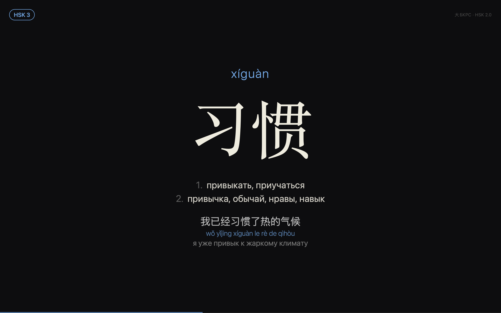
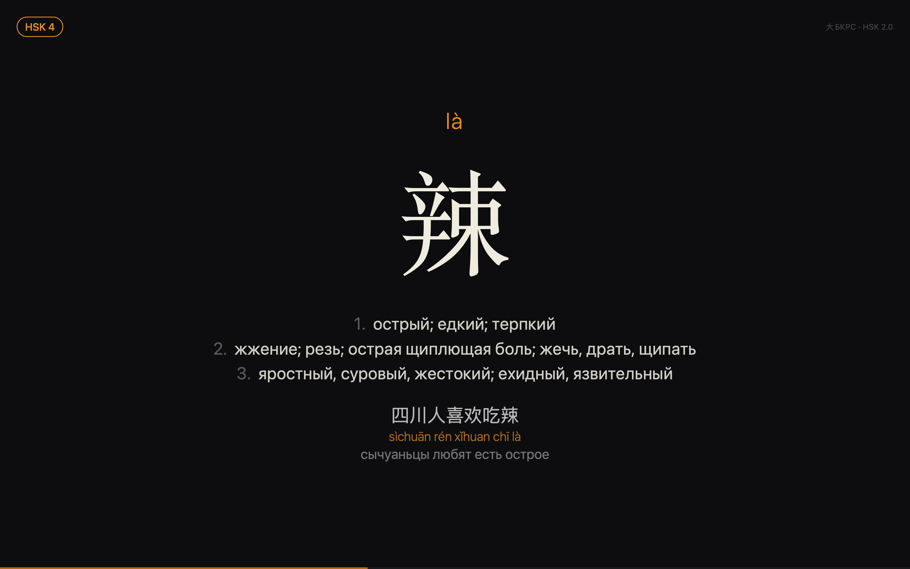

# Hanyu HSK — скринсейвер для macOS

<p>
  
  
</p>

Показывает китайские слова HSK крупными иероглифами: пиньинь, до 4 русских значений из 大БКРС и пример с пиньинем и переводом. Слова идут в случайном порядке без повторов, пока не кончится колода.

## Установка

### Готовая сборка

1. Скачайте [Hanyu-HSK.saver.zip](https://github.com/yungscientist/hanyu-screensaver/releases/latest/download/Hanyu-HSK.saver.zip) из последнего релиза и распакуйте.
2. Снимите карантин:
   ```bash
   xattr -dr com.apple.quarantine ~/Downloads/"Hanyu HSK.saver"
   ```
   Заставка подписана ad-hoc, без Developer ID и нотаризации Apple. Поэтому macOS помечает скачанный файл карантином и отказывается его открывать («не удаётся проверить разработчика»). Команда снимает эту пометку только с этого бандла. Если распаковали не в «Загрузки», поправьте путь.
3. Дважды щёлкните `Hanyu HSK.saver` и выберите установку.

### Из исходников

Нужны Command Line Tools (`xcode-select --install`), Xcode не обязателен:

```bash
./build.sh install
```

### Настройка

Откройте Системные настройки → Заставка и выберите «Hanyu HSK». Кнопка «Параметры…» открывает настройки:

- система: HSK 2.0 (уровни 1–6) или HSK 3.0 (1–6 и 7–9);
- какие уровни показывать;
- время на слово (3–30 с, плюс 1,2 с на появление и исчезновение);
- сколько значений выводить;
- показывать ли пример;
- разные слова на каждом дисплее. По умолчанию выключено: на всех экранах одно слово, и меняется оно одновременно.

## Данные

- `Resources/words.json` — готовая база (~16 тыс. карточек), лежит внутри `.saver`.
- Переводы и примеры: ежедневный дамп 大БКРС с https://bkrs.info/p47 (`data/raw/dabkrs.gz`).
- Списки слов: HSK 2.0 — [clem109/hsk-vocabulary](https://github.com/clem109/hsk-vocabulary), HSK 3.0 — [ivankra/hsk30](https://github.com/ivankra/hsk30), официальный список 2021 года с чтениями и частями речи.

Дамп в репозиторий не входит. Чтобы пересобрать базу, скачайте `dabkrs_*.gz` со страницы выше и положите его в `data/raw/dabkrs.gz`. Нужен только Python 3, без зависимостей:

```bash
./build.sh words install
```

`tools/build_words.py` для каждого слова HSK находит статью БКРС и выбирает секции с нужным чтением и частью речи. Секции с именами собственными (фамилии, топонимы) отбрасываются, если в статье есть другие. По пометам части речи (`гл.`, `сущ.`, `прил.`…) выбирается секция, а с карточки они убираются. Значения с пометами `уст.`, `книжн.`, `диал.` и т. п. уходят в конец. Пиньинь для примеров собирается по самому БКРС: пример режется на самые длинные словарные слова.

## Отблагодарить

Если заставка помогает учить китайский, проект можно поддержать на Boosty:

[](https://boosty.to/yungscientist)
